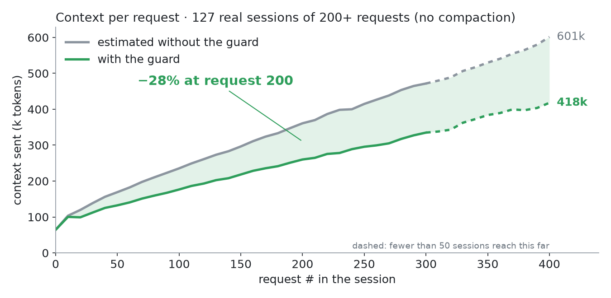
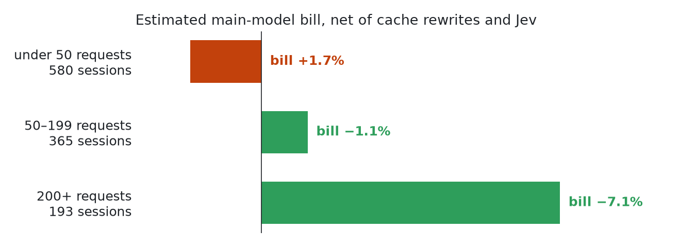

# pi-context-guard-jev

[](https://www.npmjs.com/package/pi-context-guard-jev)


**Tool output is 57% of what your [Pi](https://github.com/earendil-works/pi) agent re-sends with every
request (1,138 real sessions). This extension trims what the work no longer needs: an estimated 25% fewer
context tokens, for 1.6¢ per session.**

```bash
pi install npm:pi-context-guard-jev
```

Needs an OpenRouter key (`OPENROUTER_API_KEY` or `/login`); the footer then shows `🛡 0 saved`. Judged tool
output is sent to OpenRouter → TypeSafe ([what exactly](https://github.com/alandarev/pi-context-guard-jev/blob/master/docs/REFERENCE.md#data-sent-to-jev)).



## How it works

1. When a run ends, and at checkpoints in long runs, **Jev** (a small, fast classifier by TypeSafe) judges
   each old tool output against the question, the answer and the ongoing work.
2. Lines still needed stay verbatim; the rest becomes a one-line note. Unrelated old exchanges and
   screenshots older than 3 turns become notes too. Edits that are not expected to pay back their
   prompt-cache rewrite are skipped.
3. Every note ends with `recall({"entryId":"…"})`, so the model can fetch the original.

```text
[context-guard] Distilled the output of bash `rg -n -i compact dist docs`: kept 141 of 431 lines (15.1k of 50.4k chars); the rest was judged not needed for the answer. Full output: recall({"entryId":"1704787f"}).
```

## Measured on real work

Three weeks (October 2026) of one heavy user's everyday Pi sessions: Claude and GPT, main sessions and
subagents. "Without the guard" = the same sessions with the edits undone (an estimate, not an A/B test).

| | Context sent | Est. bill¹ | Sessions |
|---|---|---|---|
| **All** | **−25%** (10.8 billion tokens) | **−5.8%** | 1,138 |
| Claude (Anthropic) | −26% | −6.1% | 512 |
| GPT (OpenAI Codex) | −22% | −5.1% | 625 |
| Under 50 requests | −16% | **+1.7%** | 580 |
| 50–199 requests | −22% | −1.1% | 365 |
| 200+ requests | −26% | −7.1% | 193 |
| Subagents (any length) | −28% | −10% | 865 |



| | |
|---|---|
| Where the money went | $3,175 cheaper context − $2,210 prompt-cache rewrites − $18 Jev = **$948 net** on $15,459 spend |
| Items edited | 60,005: 24.6k large outputs distilled, 31.5k small outputs and 566 exchanges omitted, 3.3k screenshots removed |
| Model fetched a removed item back | **2.8%** (1.2–4.0% by type) |

¹ Estimated at each request's own token prices, net of cache rewrites and Jev. The rows are three splits of
the same sessions. The data predates 0.3.4, which skips run-end edits that do not pay off.
[Raw aggregates](https://github.com/alandarev/pi-context-guard-jev/blob/master/docs/data/real-usage.json) ·
[method and limits](https://github.com/alandarev/pi-context-guard-jev/blob/master/docs/RESULTS.md#real-usage-october-2026).

## Use

Nothing to call. `/guard` shows each decision, `/guard off` turns it off, `/tree` to a point before an edit
undoes it. Footer: `🛡 −4.2k · 3` = about 4.2k tokens kept out of context right now, by 3 edits.

Settings live in `~/.pi/agent/context-guard.json`, e.g. `{ "excludeTools": ["edit", "write", "bash"] }`
([all keys](https://github.com/alandarev/pi-context-guard-jev/blob/master/docs/REFERENCE.md#configuration)).

## Trade-offs

| | |
|---|---|
| **Third party** | Each pass sends your prompt, the answer or progress notes, short excerpts of earlier messages, tool arguments and the outputs being judged to OpenRouter → TypeSafe. Never sent: images, outputs under 400 chars, excluded tools (`edit`, `write` by default) |
| **Lossy** | A removed line can be needed later. The note says what is missing and the model can recall it (it did for 2.8% of removed items) |
| **Short sessions** | Under 50 requests: less context, but the cache rewrite costs more than it saves (+1.7% bill) |
| **Latency** | 0.5–2 s per pass, 8 s at most |

## More

[Settings](https://github.com/alandarev/pi-context-guard-jev/blob/master/docs/REFERENCE.md) ·
[Results](https://github.com/alandarev/pi-context-guard-jev/blob/master/docs/RESULTS.md) ·
[Threshold replay](https://github.com/alandarev/pi-context-guard-jev/blob/master/docs/REPLAY.md) ·
[Design](https://github.com/alandarev/pi-context-guard-jev/blob/master/docs/DESIGN.md) · MIT license
