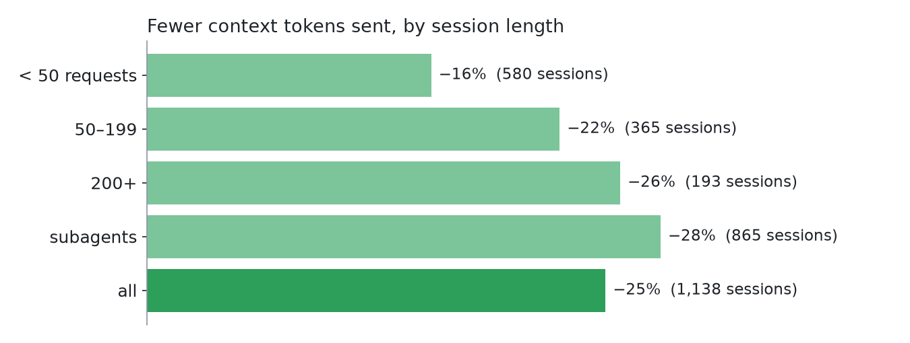

# pi-context-guard-jev

**Your [Pi](https://github.com/earendil-works/pi) agent re-sends every old tool output with every request.
This extension takes out the parts it no longer needs: 25% less context across 1,138 real sessions,
for about 1.6¢ per session.**


```bash
pi install npm:pi-context-guard-jev
```

Needs an OpenRouter key (`OPENROUTER_API_KEY` or `/login`). The footer then shows `🛡 0 saved`.

## Measured on real work

Three weeks of one heavy user's everyday sessions (October 2026), Claude and GPT, main sessions and
subagents:

| | |
|---|---|
| Sessions / model requests | **1,138 / 154,045** |
| Context tokens sent | **−25%** (10.8B fewer) |
| Long sessions (200+ requests) | **−26%**, **−30%** by request 400 |
| Main-model bill, net of prompt-cache rewrites¹ | **−5.8%** (−7.1% in long sessions, −10% in subagents) |
| Classifier cost | **$18 total**: 0.1% of the model spend |
| Removed items the model asked back for | **1–4%** |



¹ Estimated from each request's own token prices. Raw aggregates:
[docs/data/real-usage.json](docs/data/real-usage.json). Method and limits: [docs/RESULTS.md](docs/RESULTS.md).

## What it removes

| Item | Who decides | The model then sees |
|---|---|---|
| Large tool output (≥ 4k chars) | Jev keeps the lines the work still needs | The kept lines, verbatim, and one note per gap |
| Small tool output (400–4k) | Jev: still needed? | A one-line note |
| Old exchange about another task | Jev: still relevant? | A one-line note |
| Screenshot in a tool result | 3 turns old | A one-line note |

Every note says how to get the original back: `recall({"entryId":"…"})`.

```text
[context-guard] Distilled the output of bash `rg -n -i compact dist docs`: kept 141 of 431 lines (15.1k of 50.4k chars); the rest was judged not needed for the answer. Full output: recall({"entryId":"1704787f"}).
```

**Jev** is a small, fast classifier (TypeSafe, via OpenRouter). It runs when a run ends and, in long runs,
mid-run. Edits only happen when the smaller context pays back the prompt-cache rewrite they cause.

## Use

Nothing to call. `/guard` shows each decision, `/guard off` turns it off, `/tree` undoes an edit.

| Footer | Meaning |
|---|---|
| `🛡 −4.2k · 3` | 4.2k tokens kept out of context right now, by 3 edits |
| `🛡 0 · Σ−79k` | After a compaction: 79k saved in this session in total |
| `🛡 Jev failing: 402 insufficient credits` | Classifier unavailable: nothing is removed |

## Trade-offs

- **Sends data to a third party.** Each pass sends your prompt, the answer and the tool outputs being judged
  to OpenRouter and TypeSafe. Images and `edit`/`write` results are never sent.
  [Full list](docs/REFERENCE.md#data-sent-to-jev).
- **Lossy.** Removed lines can be needed later; the model sees what is missing and recalls it.
- **Short sessions:** less context, but no lower bill (the cache rewrite eats the saving).
- **Latency:** 0.5–2 s per pass.

## More

[Settings](docs/REFERENCE.md#configuration) · [Results](docs/RESULTS.md) · [Threshold replay](docs/REPLAY.md) ·
[Design](docs/DESIGN.md) · [Prompt cache](docs/CACHE.md) · [Jev questions](docs/JEV.md) · MIT license
